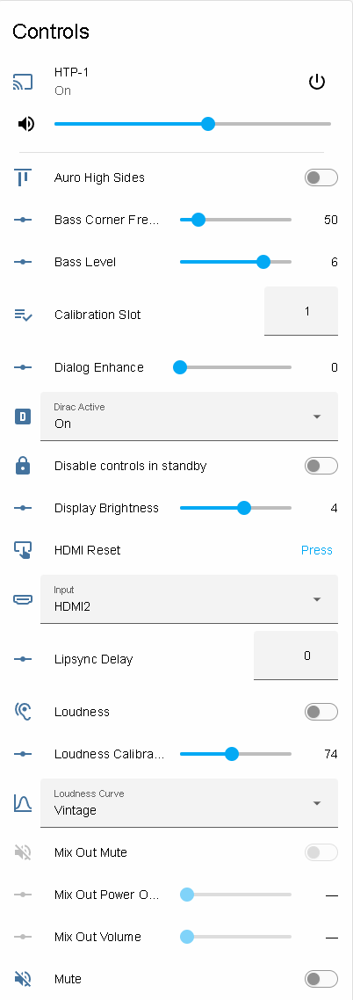
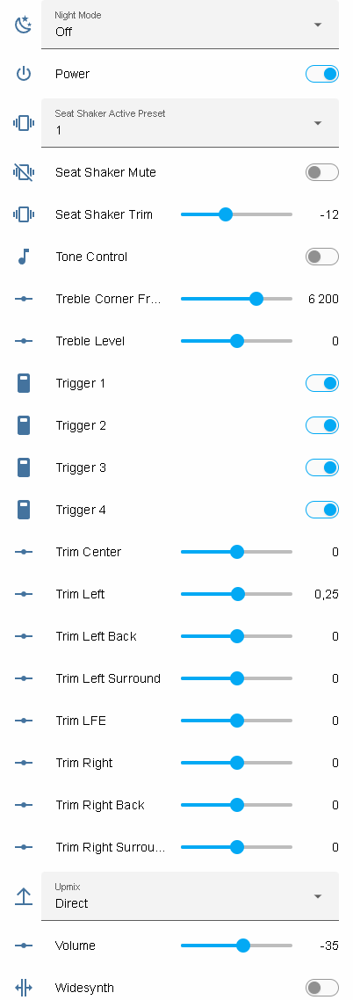
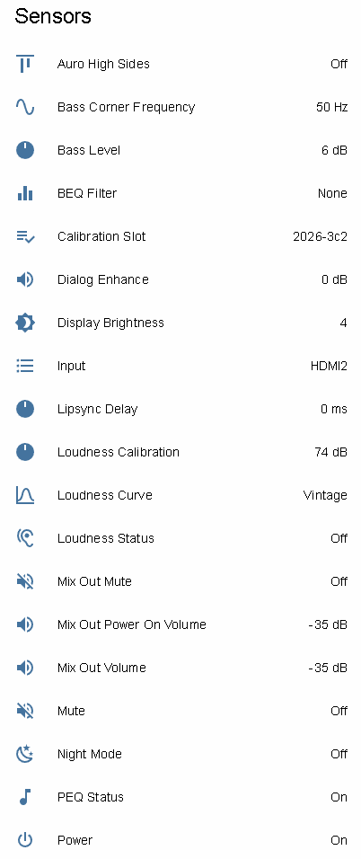
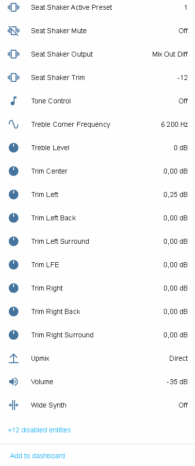
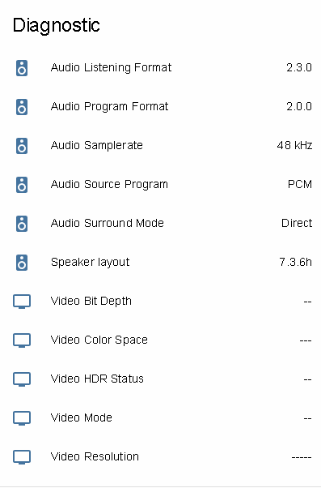

## Home Assistant integration for the Monoprice Monolith HTP-1

This repo provides [Home
Assistant](https://www.home-assistant.io/) integration for the [Monoprice
HTP-1](https://www.monoprice.com/product?p_id=37887) home theater processor.

## Installation

### Marketplace (Home Assistant 2026.11 or later)

1. In Home Assistant, go to **Settings → Marketplace**. The first time, read the notice and accept it.
2. Search for "Monoprice HTP-1" and select **Install**.
3. Follow the setup flow and enter your HTP-1's IP address.

### HACS (Home Assistant 2026.10 or earlier)

1. Make sure [HACS](https://hacs.xyz/) is installed in your Home Assistant instance.
2. In Home Assistant, open **HACS**, search for "Monoprice HTP-1" and click **Download**.
3. Restart Home Assistant.
4. Go to **Settings → Devices & Services → Add Integration**, search for "Monoprice", and follow the config flow, entering your HTP-1's IP address.

### Manual installation (alternative)

1. Download `monoprice_htp1.zip` from the [latest release](https://github.com/TimoJJ/ha-monolith-htp1/releases/latest).
2. Create the folder `custom_components/monoprice_htp1` under your Home Assistant configuration directory and unzip the file into it.
3. Restart Home Assistant.
4. Go to **Settings → Devices & Services → Add Integration**, search for "Monoprice", and enter your HTP-1's IP address.

After the integration is added, the entities appear and update in about 10-15 seconds.

## Updating

**Via Marketplace or HACS:** an update notification is shown when a new version is released. Install the update, then restart Home Assistant.

**Manual:** Delete the contents of `custom_components/monoprice_htp1`, unzip the new `monoprice_htp1.zip` into it, and restart Home Assistant.

## Bass EQ (BEQ)

The integration can load [BEQ](https://beqcatalogue.readthedocs.io/) bass correction filters onto the HTP-1 with the `monoprice_htp1.load_beq_filter` and `monoprice_htp1.clear_beq_filter` services. See [docs/BEQ.md](https://github.com/TimoJJ/ha-monolith-htp1/blob/main/docs/BEQ.md) for usage and automation examples.

## Screens

  

 

  

 

## Credits

https://github.com/ross/ha-monoprice-htp1 — used as a starting point.

